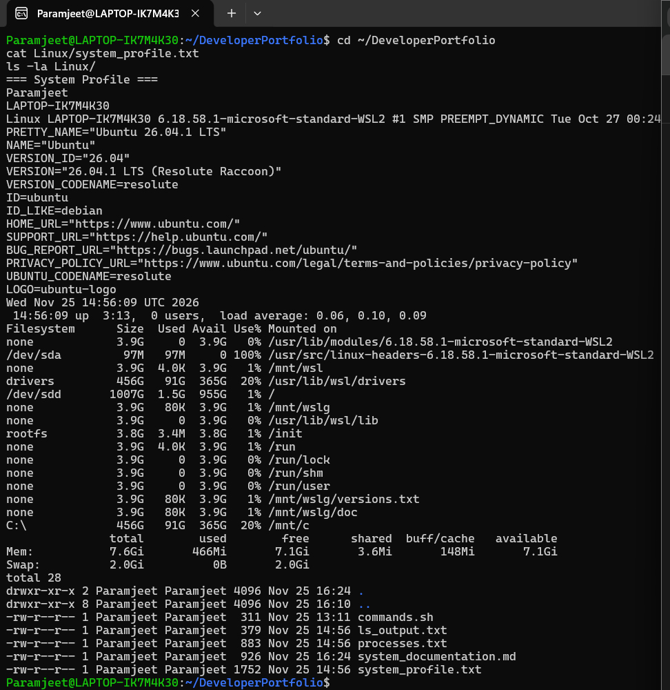
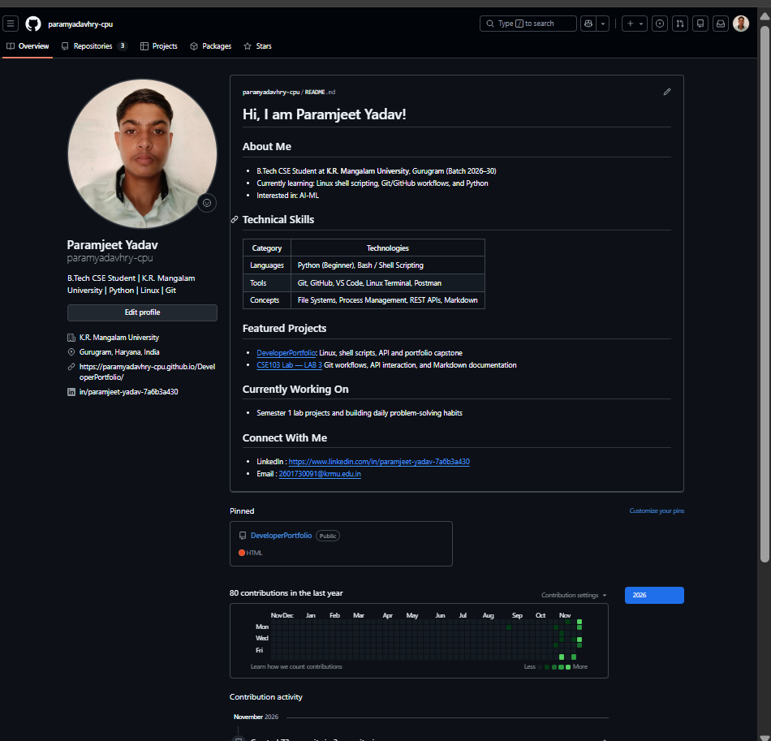
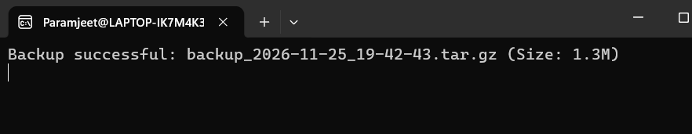
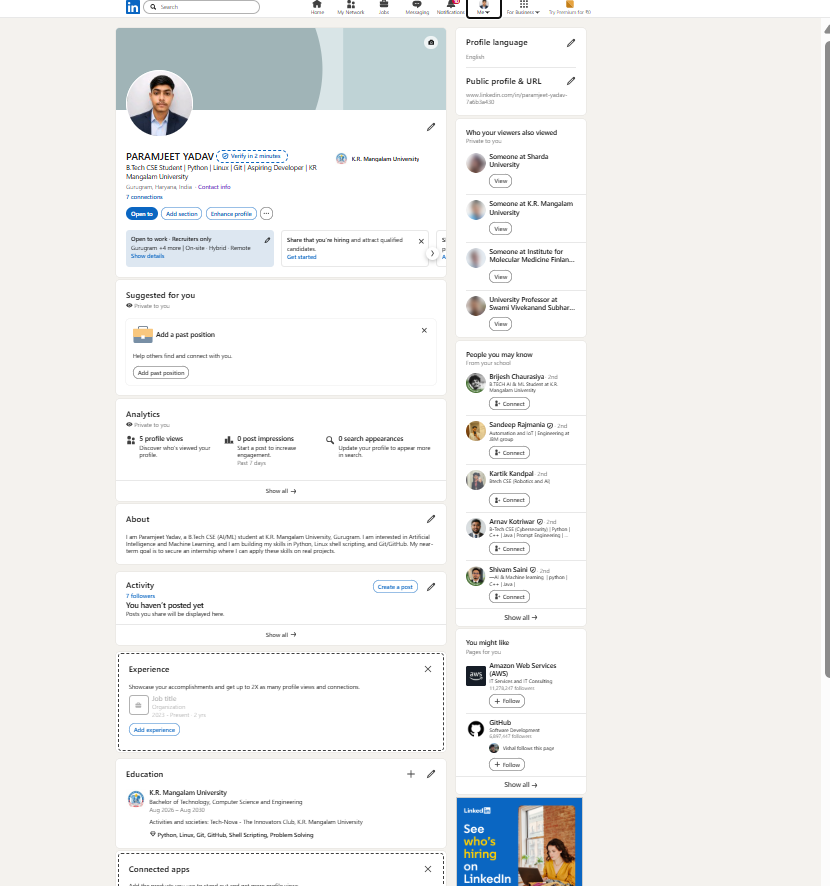

# Paramjeet Yadav — Developer Portfolio
> B.Tech CSE Student | K.R. Mangalam University, Gurugram | Batch 2026-30

---
## Project Overview
This repository is my Beginner Developer Ecosystem Portfolio for the CSE103 CS Fundamentals capstone. It brings together the work from all four labs: Linux commands, shell scripts, API interaction with Python, Git/GitHub, Markdown documentation, resume, LinkedIn profile and a learning roadmap.

## Repository Structure
```
DeveloperPortfolio/
├── Linux/          Q1 (CO1) - System profile and Linux command outputs
├── ShellScripts/   Q2 (CO2) - Bash automation scripts
├── API/            Q3 (CO3) - API response JSON and Python script
├── Portfolio/      Q4 (CO4) - Resume PDF, roadmap, LinkedIn screenshot
├── Screenshots/    Supporting screenshots for all sections
└── README.md       Project overview
```

## Student Details

- **Name:** Paramjeet Yadav
- **Roll Number:** 2601730091
- **University:** K.R. Mangalam University, Gurugram
- **Batch:** 2026-30 (B.Tech CSE)

## Live Links

- **Portfolio Website:** https://paramyadavhry-cpu.github.io/DeveloperPortfolio
- **Repository:** https://github.com/paramyadavhry-cpu/DeveloperPortfolio

## Contents

### 1. Linux (`Linux/`)
- [system_profile.md](Linux/system_profile.md): hardware and OS table, binary conversion
- [commands_output.txt](Linux/commands_output.txt): output of ls, ps, df and free
- [system_documentation.md](Linux/system_documentation.md): what each command does

### 2. Shell Scripts (`ShellScripts/`)
- [sysinfo.sh](ShellScripts/sysinfo.sh): system information report
- [sysinfo_output.txt](ShellScripts/sysinfo_output.txt): saved output of the report
- [backup.sh](ShellScripts/backup.sh): timestamped folder backup with a log

### 3. API (`API/`)
- [github_profile.json](API/github_profile.json): my GitHub profile response
- [sample_posts.json](API/sample_posts.json): posts from JSONPlaceholder
- [api_summary.md](API/api_summary.md): REST API, status codes and jq filter
- [api_fetch.py](API/api_fetch.py): Python script that fetches my profile
- [fetch_users.py](API/fetch_users.py): Python script that fetches users

### 4. Portfolio (`Portfolio/`)
- [resume.pdf](Portfolio/resume.pdf): technical resume
- [learning_roadmap.md](Portfolio/learning_roadmap.md): semester-wise plan
- [linkedin_profile.png](Portfolio/linkedin_profile.png): LinkedIn profile screenshot

## Evidence Screenshots

### Linux commands


### Shell scripts running


### API output


### GitHub profile


### Backup script


### LinkedIn profile


## Commit History

All commits follow the Conventional Commits style (`feat:`, `docs:`, `chore:`). To verify, run this from the repository root:

```bash
git log --oneline
```

## Profiles
- GitHub: https://github.com/paramyadavhry-cpu
- LinkedIn: https://www.linkedin.com/in/paramjeet-yadav-7a6b3a430

## How to Run

```bash
./ShellScripts/sysinfo.sh
./ShellScripts/backup.sh ~/DeveloperPortfolio
```
---
## Repository Index

| Repository | Description | Tech Stack |
|------------|-------------|------------|
| [DeveloperPortfolio](https://github.com/paramyadavhry-cpu/DeveloperPortfolio) | Capstone portfolio | Bash, Git, HTML |
| [cse103-lab-LAB3](https://github.com/paramyadavhry-cpu/cse103-lab-LAB3) | CSE103 lab work | Git, Python, Bash |

---

## Current Skills
- Python [■■■■■□□□□□] 50%
- Linux / Bash [■■■■□□□□□□] 40%
- Git / GitHub [■■■■■□□□□□] 50%

---

## Learning Roadmap
See [learning_roadmap.md](./Portfolio/learning_roadmap.md) for my full 6-semester plan.

## Progress Tracker
See [PROGRESS.md](./PROGRESS.md) for coding platform progress.


